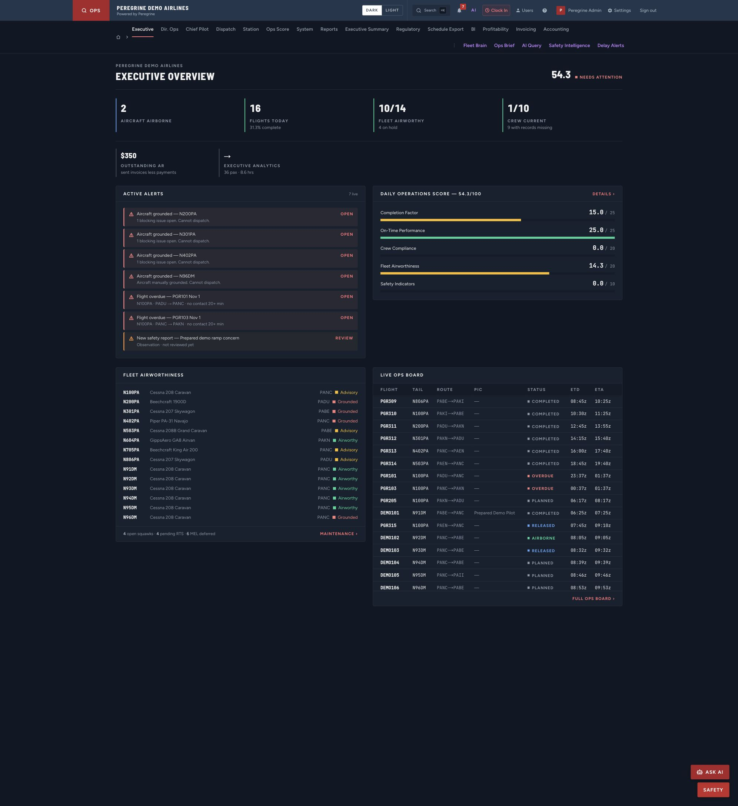
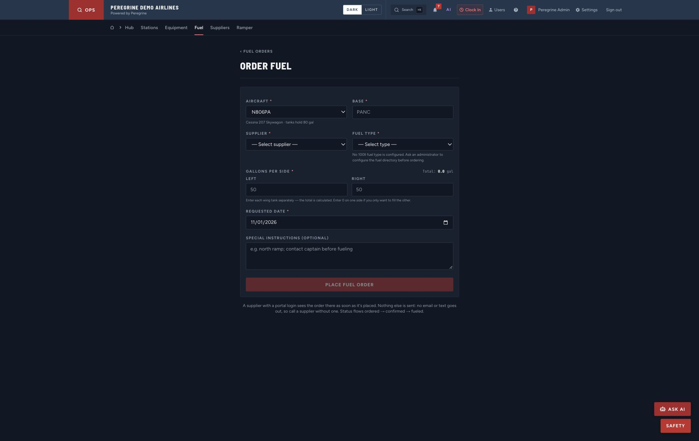
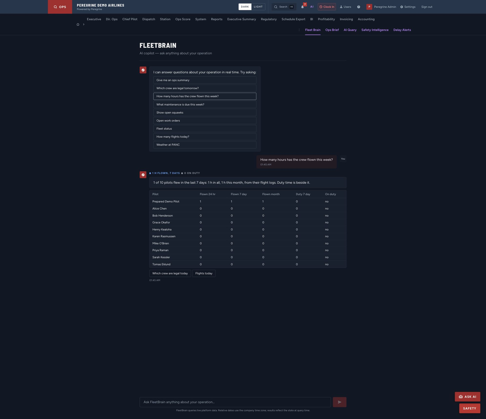
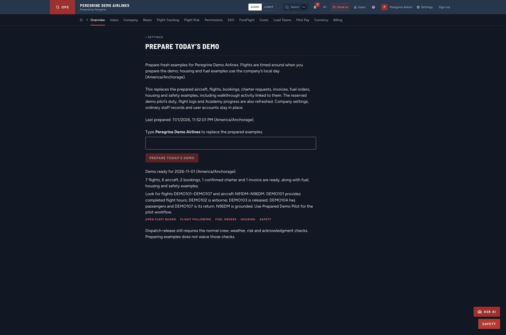
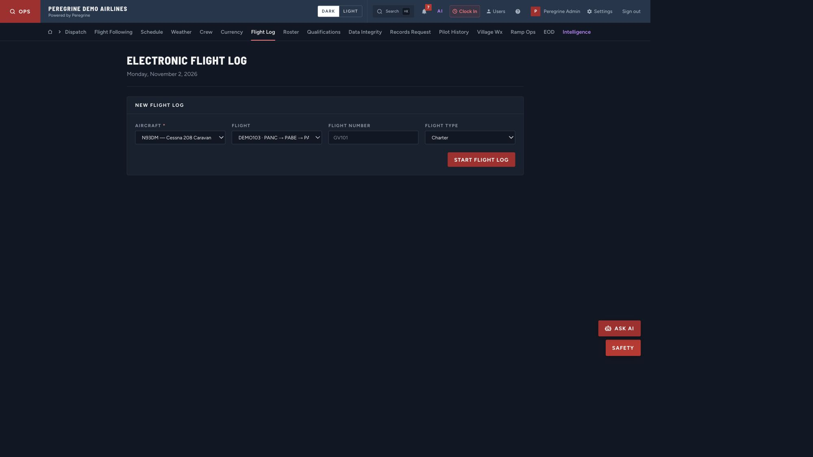
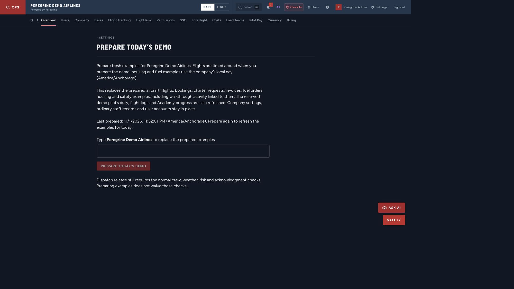
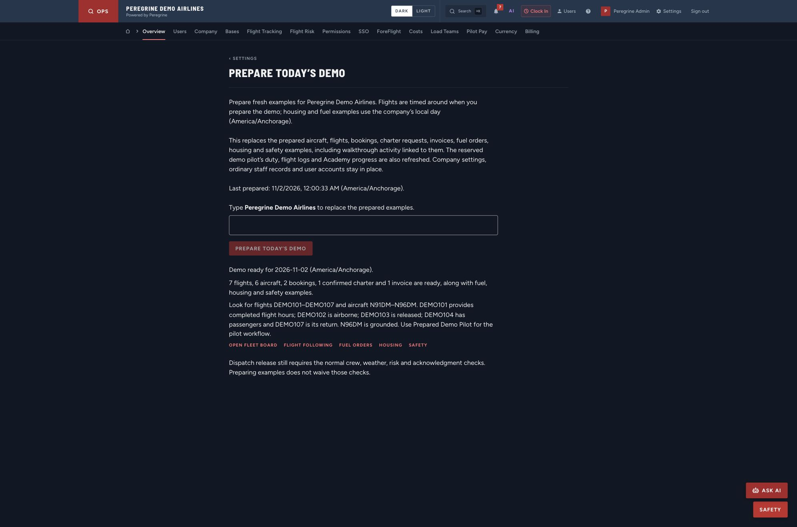
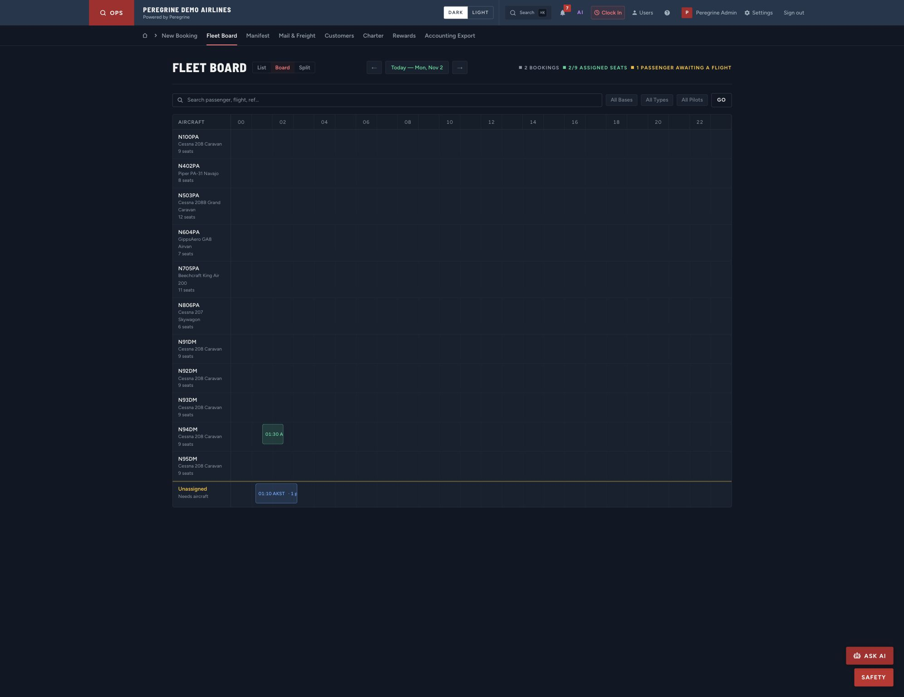

# Final browser acceptance addendum

Published in the existing **Operational burn-down — Nov 1** Google Doc tab on November 2. The saved DOCX export confirms **31 embedded screenshots** and the final 4,091-test acceptance addendum. PDF pages were visually inspected; the final summary starts on its own page.

The missing approved aircraft loading sheets block **computed CG/envelope acceptance only**. Continue the other journeys. The app explicitly identifies its weight check and requires balance verification against the aircraft’s approved loading procedure; original report 53 remains open.

The original bug tab retains its exact wording. Export readback confirms **45 numbered reports highlighted green for prior commits**. New local fixes remain unhighlighted. Historical imported data is retained for investigation rather than rewritten to create a passing result.

The production browser now confirms Home and Executive both count **2 airborne aircraft and 4 held aircraft**; Home has **8 on the ground**. Executive previously counted two overlapping flight records for one aircraft separately. The shared snapshot now counts unique aircraft, while Flight Following continues to count flight records.

Ramp Operations and new fuel orders now follow the company calendar day. Selecting the C207 offers no Jet A and, when no approved 100LL type is configured, explains the missing directory setup and disables submission. The below-plan case also passed: a 100-gallon uplift against a 149.3-gallon plan asks staff to check what is already aboard.

The refreshed completed scheduled flight yields **1.00 Part 135 hour** in every roster window. FleetBrain independently answers **1 hour flown / 0 duty hours**, using the same records.

Founder refresh passed through the production web client at **08:52:01 UTC November 2** for company day November 1: **7 flights, 6 aircraft, 2 bookings, 1 confirmed charter and 1 invoice**, plus ground, housing and safety examples. It removed owned walkthrough activity and preserved accounts, credentials and company settings. The control now explains that the reserved demo pilot’s logs, duty and Academy progress are disposable. Local type-qualification enforcement was explicitly enabled; reset preserves that policy. No deployed setting changed.

The staged multi-stop example retains **PANC → PABE → PANC** in the actual flight-log selector. This verifies intermediate-stop display; staged released examples do not certify a real dispatch release.

Validation: **4,091 frontend tests / 448 files** passed, with 13 focused ground/demo tests after final copy/fetch changes. Production build, TypeScript and lint passed. Backend suites passed for release/departure (162), extended duty/currency/risk/board (128), ground/fuel/GSE (139), maintenance/inspections (35), medical/weather (55), integrity (40), packet/counts (16), FleetBrain (90), fixture (10), and legacy scenario guard (101). Counts overlap earlier runs and are not summed.

Existing ground assignment, photo upload, mail payload and fuel exact/short-delivery branches passed. Timestamped team received/working/complete states and load-complete notifications remain an absent feature, not implied by a photo. LMS expansion is separate per the user’s decision. Remaining operational data/configuration and unbuilt modules are recorded in [open-uat-prerequisites.md](open-uat-prerequisites.md). Deployment and source-environment historical cleanup remain deferred.

## Natural midnight rollover

At Anchorage midnight the app displayed **Prepare again to refresh the examples for today**. The admin web refresh at **09:00:33 UTC** rebuilt company day **November 2**, retaining the same counts and preserving the enabled type gate. The current Fleet Board showed **Today — Mon, Nov 2** with a current-day 01:30 outbound and 01:10 waiting request. No duplicate prepared flights accumulated.

The waiting fixture exposed a final BF19 case: its passenger was included in the occupied-seat numerator. The board now shows **2/9 assigned seats** and **1 passenger awaiting a flight**. Aircraft preferences without actual flight assignments do not contribute capacity. The final full suite passed **4,091 tests /448 files**, and production browser acceptance confirms both figures.

